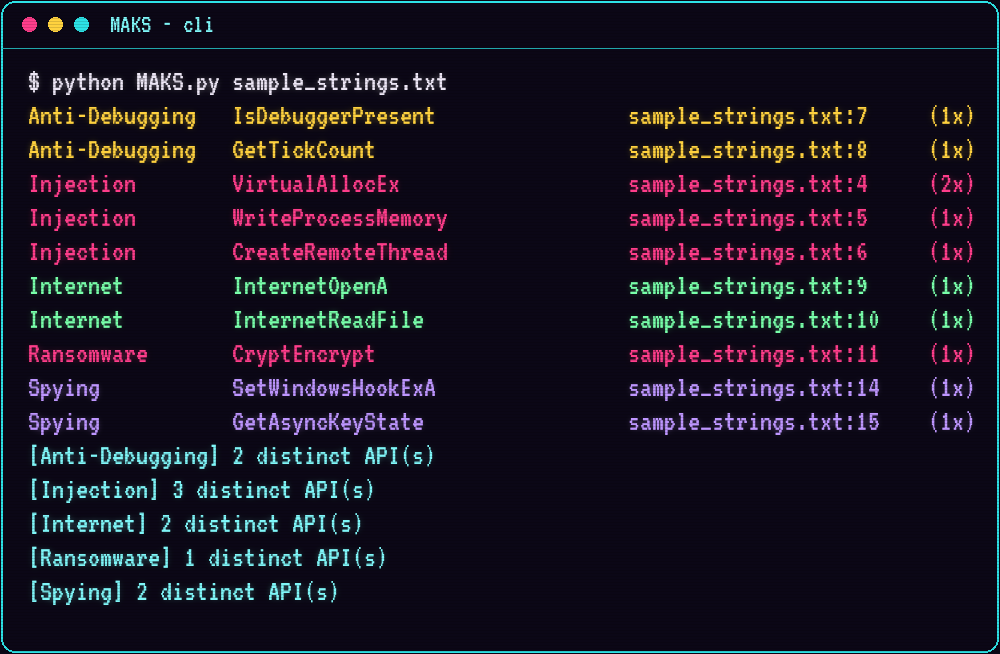

<p align="center"></p>

# MAKS — Malware API Keyword Search

MAKS scans text dumps of a suspicious binary (output of `strings`, FLOSS, or an import-table export) for Windows API calls that malware commonly abuses, and groups every hit by behaviour: **Injection, Evasion, Anti-Debugging, Spying, Ransomware, Internet, Enumeration, Helper**.

It's a fast first-pass triage step: before opening a sample in a disassembler, you already know whether it imports `VirtualAllocEx` + `WriteProcessMemory` + `CreateRemoteThread` (classic process injection) or `SetWindowsHookExA` + `GetAsyncKeyState` (keylogging).

<p align="center"></p>

## Features

- **GUI and CLI.** Point-and-click on Windows, or run headless on REMnux / any Linux box.
- **Categorised results.** Each hit shows category, API name, file, first line seen, and number of occurrences.
- **Editable database.** Each category is a plain `.txt` file with one API name per line. Add a file, get a new category.
- **CSV or TXT reports.** CSV drops straight into Excel or a SIEM lookup.
- **Robust on messy input.** Non-UTF-8 bytes from binary string dumps are ignored instead of crashing the scan.

## Quick start

```bash
git clone https://github.com/64BitZayn/MAKS.git
cd MAKS

# Get printable strings from a sample (Linux / REMnux)
strings -n 6 sample.exe > sample_strings.txt

# Or try the included example
python3 MAKS.py examples/sample_strings.txt

# CLI: print hits to the terminal
python3 MAKS.py sample_strings.txt

# CLI: save a report
python3 MAKS.py sample_strings.txt -o results.csv

# GUI
python3 MAKS.py
```

Python 3.8+ with no third-party packages. The GUI uses Tkinter, which ships with Python on Windows. On Debian/Ubuntu install it with `sudo apt install python3-tk`.

**Windows binary:** a prebuilt `MAKS.exe` is attached to the [latest release](https://github.com/64BitZayn/MAKS/releases/latest), with its SHA-256 listed in the release notes. Keep the `Malicious API database` folder next to the `.exe` and it is loaded automatically.

## GUI


https://github.com/user-attachments/assets/93aea727-dd08-48dc-8555-5c3cab09c42a

## Example output

**CSV**

| Category  | Matched Keyword    | Input File         | First Line | Occurrences |
| --------- | ------------------ | ------------------ | ---------- | ----------- |
| Injection | VirtualAllocEx     | sample_strings.txt | 4          | 2           |
| Injection | WriteProcessMemory | sample_strings.txt | 5          | 1           |
| Spying    | GetAsyncKeyState   | sample_strings.txt | 15         | 1           |

**TXT**

```
Category: Injection
    VirtualAllocEx found in sample_strings.txt on line 4 (2x)
    WriteProcessMemory found in sample_strings.txt on line 5 (1x)
```

## The keyword database

```
Malicious API database/
├── Anti-Debugging.txt
├── Enumeration APIs.txt
├── Evasion.txt
├── Helper.txt
├── Injection.txt
├── Internet.txt
├── Ransomware.txt
└── Spying.txt
```

The initial API lists come from [MalAPI.io](https://malapi.io), which maps Windows APIs to the malicious techniques they are used for.

## Limitations

A hit means an API name appears in the text, not that the sample calls it maliciously. Plenty of legitimate software imports `VirtualAlloc` or `InternetOpenA`. Packed or obfuscated samples may hide their imports entirely, so an empty result is not a clean bill of health. Use MAKS to decide where to look next, not as a verdict.

## License

[MIT](LICENSE)
